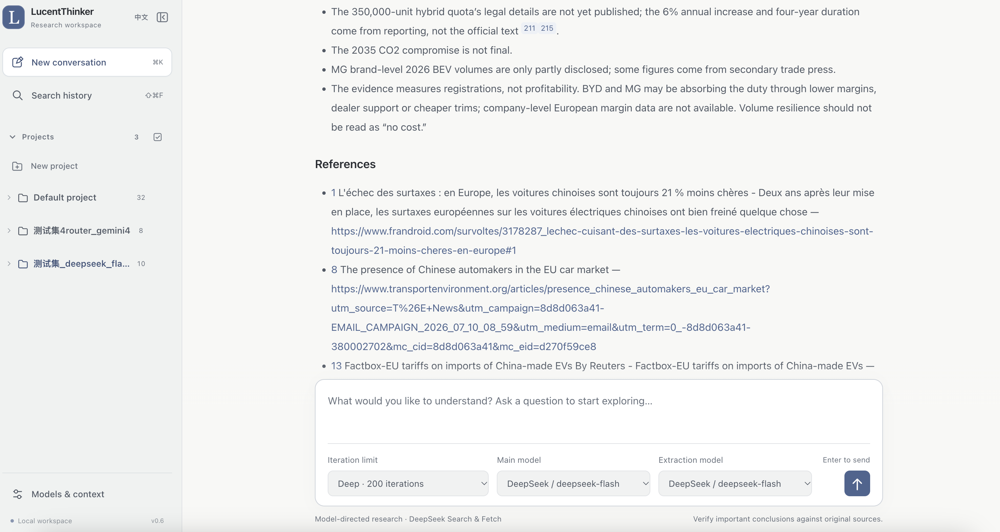
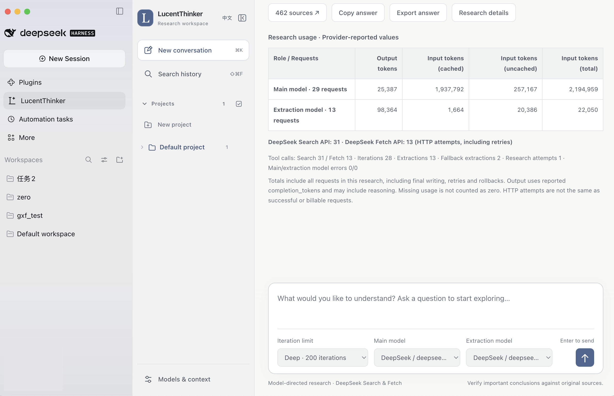
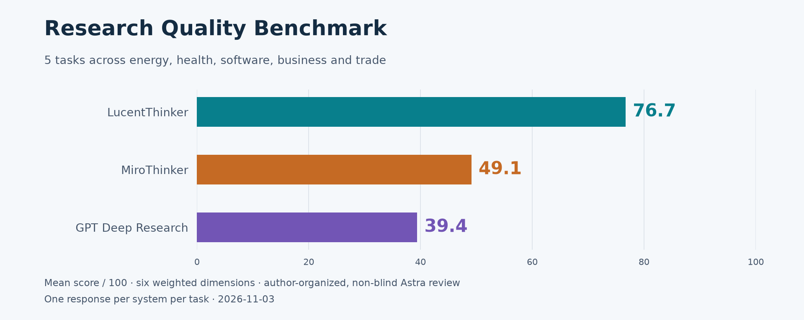
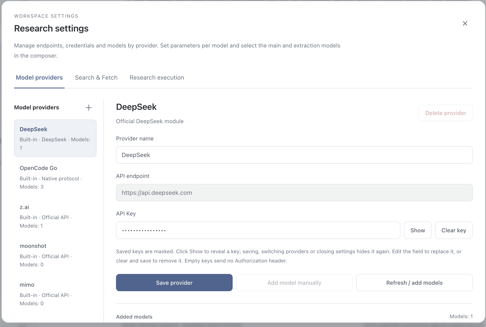
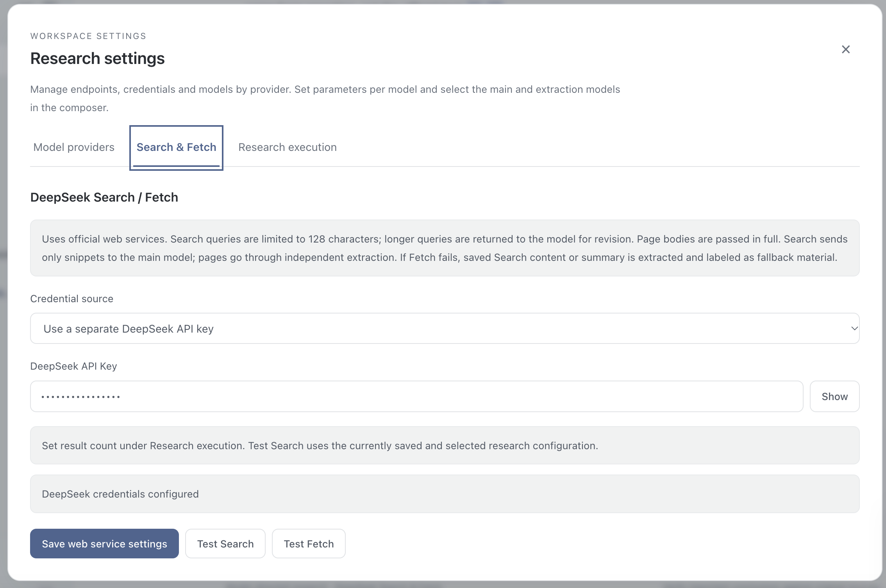

# LucentThinker — Fast, Reliable Deep Research. Free, Open Source, Local.

[中文](README.zh-CN.md)

A local personal research assistant powered by DeepSeek. It searches the web, reads sources and writes research reports with citations.

- Higher research-quality scores than GPT Deep Research and paid MiroThinker in this benchmark.
- Adjustable research depth, locally saved history.
- Bring your own API keys. Author-reported costs start around RMB 1 per run, roughly US$0.20, depending on the task and provider pricing.

## Interface

### Web UI



### DeepSeek Harness plugin



## Benchmark

Five research tasks across energy, health, software, business and trade, comparing LucentThinker with paid MiroThinker deep mode and GPT Deep Research.



Author-organized, non-blind Astra evaluation. One response per system per task.

[Report & answers](benchmarks/2026-11-02/en/README.md) · [Questions](benchmarks/2026-11-02/en/questions.md) · [Scoring](benchmarks/2026-11-02/en/methodology.md) · [Download ZIP](benchmarks/2026-11-02/lucentthinker-benchmark-en.zip)

## Install

**DSH plugin** — Open **Plugins → Add plugin**, enter `dsh-plugin-lucentthinker`, and enable it. Includes runtimes for macOS Apple Silicon and Windows x64. [Plugin guide](dsh-plugin/README.md)

**Standalone Web UI** — Install [uv](https://docs.astral.sh/uv/getting-started/installation/), then clone the project.

```sh
git clone https://github.com/XinYu-pumch/LucentThinker.git
cd LucentThinker
```

On **macOS**, run the following command or double-click `Launch LucentThinker.command`.

```sh
./start.sh --open
```

On **Windows**, double-click `start.cmd`.

Dependencies install automatically, then the UI opens at [localhost:8765](http://127.0.0.1:8765). Close the launch terminal or press Ctrl+C to stop.

## Configure

1. In Settings, enter your DeepSeek API key under both **DeepSeek** and **Search & Fetch**.

   

   

2. Refresh the model list and add **DeepSeek Flash**. Set its thinking level to **Max** (recommended), then select it for both the **main model** and **extraction model**.
3. Choose a research depth, enter your question, and start.

Other providers are supported, with thinking configurations for major model families. [Advanced guide in Chinese](docs/advanced.zh-CN.md)

## Acknowledgements

[LINUX DO](https://linux.do/) · [Reddit](https://www.reddit.com/)

## License

[GPL-3.0-or-later](LICENSE) · [Attribution and notices](NOTICE)
