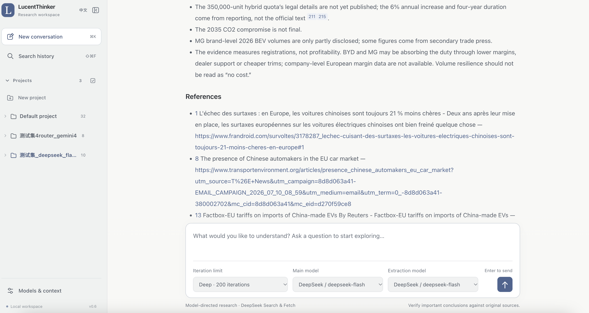
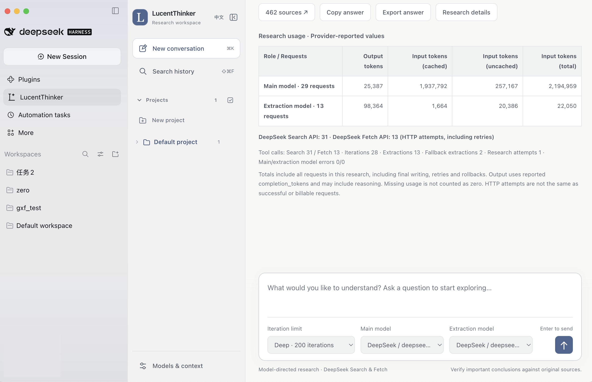
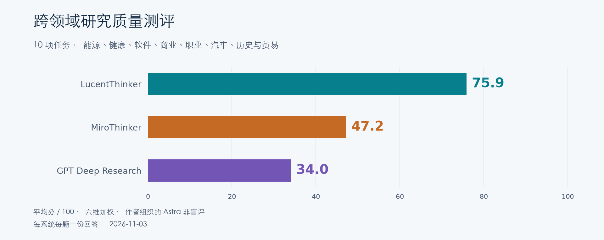
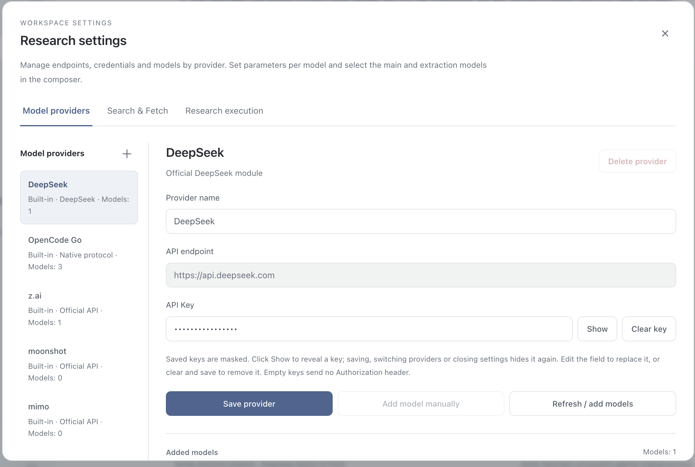
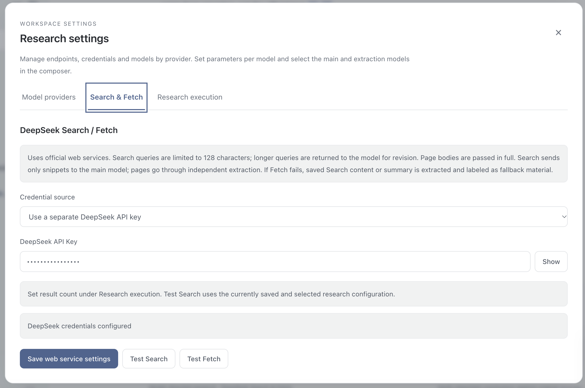

# LucentThinker

[English](README.md)

**快速调研，来源可查，低成本运行。**

基于 DeepSeek 服务的本地个人研究助手，自主搜索网页、阅读来源，并生成带引用的研究报告。

- 按需选择研究深度，研究历史保存在本地。
- 使用自己的 API Key。作者使用经验中单次调研低至约 1 元人民币，美元预算可粗略参考 0.20 美元，实际费用取决于研究深度和服务定价。

## 界面

### Web UI



### DeepSeek Harness 插件



## Benchmark

十项任务覆盖能源、健康、软件、商业、职业、汽车、历史与贸易，对比 LucentThinker、付费 MiroThinker deep 模式和 GPT Deep Research。



作者组织的 Astra 非盲评，每系统每题一份回答。十题含一组同题中英对照。

[报告与回答](benchmarks/2026-11-02/zh/README.md) · [完整问题](benchmarks/2026-11-02/zh/questions.md) · [评分标准](benchmarks/2026-11-02/zh/methodology.md) · [下载 ZIP](benchmarks/2026-11-02/lucentthinker-benchmark-zh.zip)

## 安装

**DSH 插件** — 在 **插件 → 添加插件** 中填写 `dsh-plugin-lucentthinker` 并启用。包含 macOS Apple Silicon 和 Windows x64 运行时。[插件说明](dsh-plugin/README.md)

**独立 Web UI** — 安装 [uv](https://docs.astral.sh/uv/getting-started/installation/)，然后克隆项目。

```sh
git clone https://github.com/XinYu-pumch/LucentThinker.git
cd LucentThinker
```

**macOS** 运行以下命令，或双击 `Launch LucentThinker.command`。

```sh
./start.sh --open
```

**Windows** 双击 `start.cmd`。

依赖自动安装，随后打开 [localhost:8765](http://127.0.0.1:8765)。关闭启动终端或按 Ctrl+C 可退出。

## 配置

1. 在设置中的 **DeepSeek** 和 **Search & Fetch** 两处填写 DeepSeek API Key。

   

   

2. 刷新并添加 **DeepSeek Flash** 模型，推荐将其**思维档位设为 Max**，再同时选为**主模型**和**摘要模型**。
3. 按需选择研究深度，输入问题并开始。

也支持其他供应商，内置主流模型的思考配置。[进阶使用说明](docs/advanced.zh-CN.md)

## 鸣谢

[LINUX DO](https://linux.do/) · [Reddit](https://www.reddit.com/)

## 开源许可

[GPL-3.0-or-later](LICENSE) · [署名与第三方声明](NOTICE)
