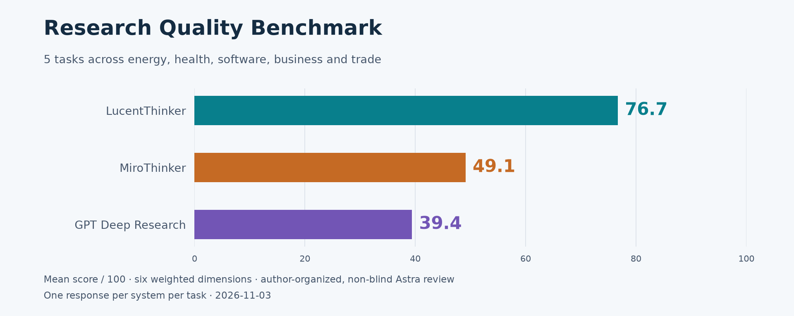

# Research Quality Benchmark

Five tasks across energy, health, software, business and trade.

[Full report](index.html) · [Questions](questions.md) · [Scoring method](methodology.md) · [Scores and evidence](scores.json)

For offline reading, download this edition's ZIP from the parent directory, extract it and open index.html.

Author-organized, non-blind Astra review, one response per system per task.

| Task | LucentThinker | MiroThinker | GPT Deep Research |
| --- | --- | --- | --- |
| Home battery economics | [76.0](responses/lucentthinker/q01.md) | [49.0](responses/mirothinker/q01.md) | [39.0](responses/gpt-deepresearch/q01.md) |
| Creatine and cognition | [78.0](responses/lucentthinker/q02.md) | [53.5](responses/mirothinker/q02.md) | [51.5](responses/gpt-deepresearch/q02.md) |
| B2B search architecture | [83.5](responses/lucentthinker/q03.md) | [53.5](responses/mirothinker/q03.md) | [42.5](responses/gpt-deepresearch/q03.md) |
| Costco vs. Walmart | [70.5](responses/lucentthinker/q04.md) | [40.0](responses/mirothinker/q04.md) | [34.5](responses/gpt-deepresearch/q04.md) |
| EU tariffs and Chinese EVs | [75.5](responses/lucentthinker/q10.md) | [49.5](responses/mirothinker/q10.md) | [29.5](responses/gpt-deepresearch/q10.md) |

[PNG](score.png) · [SVG](score.svg) · [SHA-256](manifest.json)
