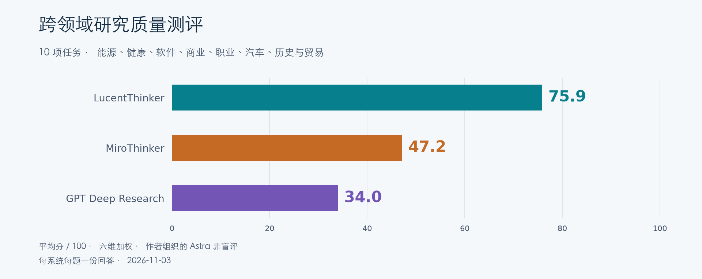

# 跨领域研究质量测评

十项任务覆盖能源、健康、软件、商业、职业、汽车、历史与贸易，包含九个主题和一组同题中英对照。

[完整报告](index.html) · [完整问题](questions.md) · [评分方法](methodology.md) · [评分与证据](scores.json)

离线阅读请下载上级目录对应 ZIP，解压后打开 index.html。

作者组织的 Astra 非盲评，每系统每题一份回答。

| 任务 | LucentThinker | MiroThinker | GPT Deep Research |
| --- | --- | --- | --- |
| 家庭电池经济性 | [76.0](responses/lucentthinker/q01.md) | [49.0](responses/mirothinker/q01.md) | [39.0](responses/gpt-deepresearch/q01.md) |
| 肌酸与认知表现 | [78.0](responses/lucentthinker/q02.md) | [53.5](responses/mirothinker/q02.md) | [51.5](responses/gpt-deepresearch/q02.md) |
| B2B 搜索架构 | [83.5](responses/lucentthinker/q03.md) | [53.5](responses/mirothinker/q03.md) | [42.5](responses/gpt-deepresearch/q03.md) |
| Costco 与 Walmart | [70.5](responses/lucentthinker/q04.md) | [40.0](responses/mirothinker/q04.md) | [34.5](responses/gpt-deepresearch/q04.md) |
| 三城工作机会 | [81.5](responses/lucentthinker/q05.md) | [34.0](responses/mirothinker/q05.md) | [27.5](responses/gpt-deepresearch/q05.md) |
| 上海换购纯电车 | [68.0](responses/lucentthinker/q06.md) | [37.5](responses/mirothinker/q06.md) | [18.0](responses/gpt-deepresearch/q06.md) |
| 钙钛矿商业化 | [72.5](responses/lucentthinker/q07.md) | [55.0](responses/mirothinker/q07.md) | [33.0](responses/gpt-deepresearch/q07.md) |
| 郑和远航与海洋贸易 | [82.5](responses/lucentthinker/q08.md) | [55.5](responses/mirothinker/q08.md) | [36.0](responses/gpt-deepresearch/q08.md) |
| 欧盟关税与中国电动车 · 中文提问 | [70.5](responses/lucentthinker/q09.md) | [44.0](responses/mirothinker/q09.md) | [28.5](responses/gpt-deepresearch/q09.md) |
| 欧盟关税与中国电动车 · 英文提问 | [75.5](responses/lucentthinker/q10.md) | [49.5](responses/mirothinker/q10.md) | [29.5](responses/gpt-deepresearch/q10.md) |

[PNG](score.png) · [SVG](score.svg) · [SHA-256](manifest.json)
