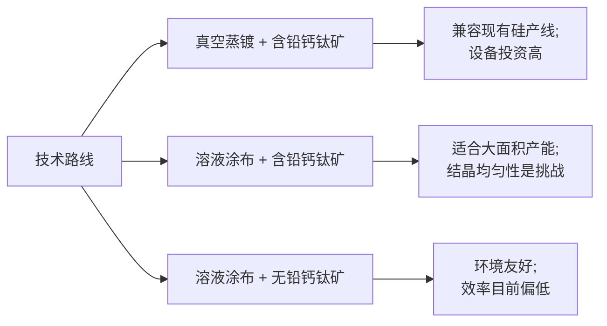
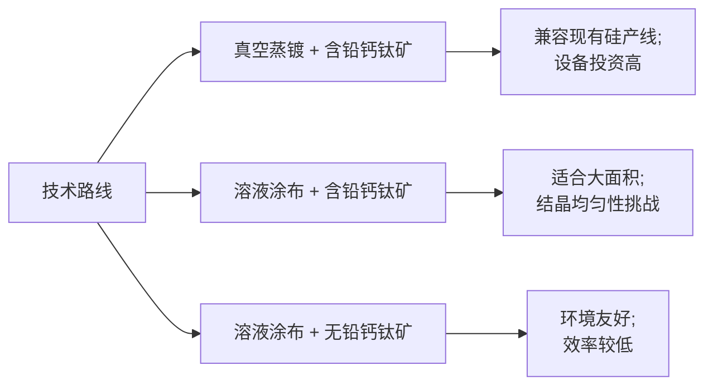

# 执行摘要

截至2026年10月，牛津光伏（Oxford PV）在实验室规模上已取得业界领先成绩：其在德国Fraunhofer ISE认证下实现258.15 cm²钙钛矿/晶硅叠层电池28.6%转换效率。该结果表明其采用真空PVD工艺在全尺寸晶硅片上实现高效率，但目前仅为电池片级数据，尚无公开的组件级认证效率。协鑫光电旗下昆山钙钛矿项目已建成GW级产线，并于2025年下线全球最大尺寸（2400×1150 mm）单结钙钛矿组件，凸显其规模化进展，但报道并未给出叠层组件效率与测试数据。纤纳光电目前公开信息极少，无独立验证数据可查。三者均采用含铅钙钛矿材料，需关注封装和铅泄漏风险。总的来看，钙钛矿/硅叠层技术商业化仍处于初期，各公司多以企业公告为主，缺乏足够的第三方认证报告和长期可靠性数据。建议投资前严格核查认证数据、长期测试和成本模型。

## 公司对比（公司×维度）

| 维度                    | 牛津光伏（Oxford PV）                            | 协鑫光电（GCL）                                    | 纤纳光电（XINNA）      |
|-----------------------|------------------------------------------|--------------------------------------------|-----------------|
| 1. 小面积电池效率 （认证效率、测试机构） | 已获Fraunhofer ISE认证：258.15 cm² 叠层电池28.6%；此前曾有27%纪录。三方认证保证数据真实性。 | 无公开独立认证数据。公司宣称其钙钛矿/硅叠层电池稳态效率达29.51%（新闻报道）；但缺乏权威认证。 | 未公开实验室效率数据，仅有公司宣称或学术报道；无可验证证据。 |
| 2. 大面积组件效率 （封装后、尺寸、测试标准） | 公司官网声称已出货25%效率叠层组件，计划2027年达27%。但该数据无第三方认证，仅为企业目标。未见公开的玻璃封装组件效率测试结果。 | 已下线2.76 m²单结钙钛矿组件，但叠层组件效率未披露。无公开组件级认证报告。目前暂无工业化叠层组件效率数据。 | 无公开大面积组件测试数据或认证报告。若有发布也仅为公司公告，无独立验证。 |
| 3. 产线产能 （已投产/规划、产线类型、关键设备） | 在德国已购置博世（Bosch）旧厂建立试点产线。目前为集成示范线，规模估计为百MW级，可生产可测量电池片。未来产能规划未公开具体GW级目标。 | 昆山建立了GW级钙钛矿产线，首批全尺寸组件下线。公司称产线及设备国产化，实现自主IP。截至2023年，计划先跑通100MW示范线。 | 未披露任何产线计划或投产消息，推测仅处于中试或研发阶段。公众无相关公开信息。 |
| 4. 实际出货量/商业客户 （合同、交付、验收） | 官方宣称“首批商业级组件已出货”（25%组件），但暂无独立审计或客户公开验收报告。亦未见具体签约项目或客户名单。 | 媒体报道及董事长言论提及已实现订单交付，但未公开合同和客户信息。目前可视为自建产线初步试生产，未见上市销售案例。 | 无公开出货或合作项目报告。若有进展，仅依赖企业公告。 |
| 5. 组件可靠性/老化测试 （户外性能、85℃85%湿热、UV、循环、PID等） | 没有公开的组件耐久性测试结果。公司强调需与组件商合作验证性能，但目前尚处实验室阶段。独立机构尚未发布长期测试报告。 | 董事长表示在IEC 61215标准测试下性能未劣于晶硅；强调1000小时以上加速测试无明显衰减。但具体湿热、热循环、PID数据未见公开。 | 无公开加速老化或户外运行数据。缺乏独立测试或认证信息。 |
| 6. 封装方案与铅泄漏风险     | 未公开封装结构。业内普遍采用双玻璃封装以防止钙钛矿层失效和铅泄漏。研究建议在钙钛矿层表面等处增设氧化铝等物理屏障来阻止铅离子外泄。若管理不当，铅泄漏风险需重点关注。 | 同样使用含铅钙钛矿层，具体封装方案未披露。按报道所述为“多维度技术突破”，应包含封装改进，但目前无泄漏测试数据。 | 预计也使用含铅钙钛矿，封装及铅泄漏风险与上述类似，但公开资料缺失，需重点验证。 |
| 7. 良率与工艺稳定性       | 尚无公开产线良率数据。CEO Ward表态正聚焦提高商业化电池产量和良率。在德国示范线已有多片效率接近纪录，说明过程有一定稳定性，但量产良率尚待验证。 | 采用PVD+溶液涂布+激光刻蚀路线，此工艺从2017年起已确定并持续优化。范斌称该路线已能完成大面积组件制造，暗示工艺可控。缺乏详尽良率数据。 | 未公开工艺路线或良率。一般而言，溶液涂布技术稳定性和一致性需验证，良率水平待实验数据支撑。 |
| 8. 设备兼容性与硅产线改造需求 | 宣称可兼容现有晶硅产线：Oxford PV官网提到可用现有工业涂布设备制造钙钛矿层；Parkworld报道GCL也指出组件“可兼容现有硅基生产线”。说明两者均以在现有线增设工艺单元为目标，改造需求相对较小。 | 同上。GCL强调沿用晶硅产线基础，补充钙钛矿涂覆和结晶设备。已规划少量专用设备（如高精度涂布机），但无需全线重建。 | 不明。若采用溶液涂布，理论上可添加涂布&烘干设备，但具体兼容性需调查。若目标与上述公司类似，改造量大致可控。 |
| 9. 成本（每瓦/CAPEX）    | 未见独立成本分析。Oxford PV宣称串联组件能降低度电成本，但未给出具体数值。一般预期钙钛矿层材料廉价，效率增益抵消额外制程开销，但需验证制造和投资成本。 | 同样无公开成本明细。GCL强调国产化装备和技术，暗示控制成本，但实际每瓦成本受良率和批量影响，尚无独立估算。 | 未公开。通常溶液法钙钛矿具备低材料成本优势，但大规模良率和寿命影响成本，需要具体数据评估。 |
| 10. 商业化声明的证据级别  | **第三方证据**：有Fraunhofer认证的电池效率，OxPV官网有组件效率目标。**自家公告**：组件出货、路线图等。缺乏独立认证的组件数据。 | **第三方证据**：暂无公开独立测试。**媒体和公告**：董事长访谈和地方新闻报道的性能与产线信息。 | **第三方证据**：无。所有信息仅限于公司宣传，缺少任何独立验证。 |

## 技术路线差异与风险路径

不同公司在钙钛矿层制备与工艺上有所差异，这直接影响产线改造需求、成本和稳定性。下图用流程图说明三类典型技术路线及其优缺点：

- **真空蒸镀含铅路线**（如Oxford PV）：直接在晶硅电池上真空沉积钙钛矿层，兼容现有硅电池产线，可利用现有涂布工艺和封装线，但真空设备投资和工艺成熟度要求高，批量产线成本大。  
- **溶液涂布含铅路线**（如GCL）：在硅片或玻璃基底上涂布钙钛矿前驱液，成本较低且适合大面积涂覆，但湿态涂布后的结晶控制难度更高，对环境和封装稳定性要求高，需要严格温控和制程管理。  
- **无铅路线**：采用锡或其它无铅钙钛矿材料，可消除铅污染风险（环境安全性高），但目前转化效率远低于含铅体系（一般<15%），商业化进程滞后。  

上述工艺差异将影响前述各维度：如真空工艺强调设备CAPEX与产能规划，溶液工艺关注均匀性与产线兼容性，是否含铅影响封装策略和环境规范符合性。投资评估应考虑对应路线的风险点：如溶液涂布需要验证大面积一致性和长期稳定性，而无铅路线则需平衡效率与安全性。

## 尽调需索取的数据/文件清单（按优先级）

- **电池/组件认证报告**：由Fraunhofer ISE、NREL等机构出具的钙钛矿/硅叠层电池和组件效率认证报告，包含测试条件及效率值。  
- **组件测试数据**：封装后组件的效率、功率容差及IV曲线，最好有独立实验室数据。包括IEC 61215类标准测试结果（85℃/85%湿热1000h、热循环、UV稳定性、PID等）报告。  
- **生产产能与进度文件**：产线设计说明、设备清单、产能规划（MW级）、已投产生产线（试验线）报告和产能产量证明（如测试片数量、产线利用率）。  
- **样品与交付记录**：提供钙钛矿/硅叠层组件样片，并要求客户验收报告或示范项目合同书，验证实际出货和工作性能。  
- **长期可靠性数据**：现场运行数据或加速老化实验数据，如长期光老化、热循环寿命测试结果及失效率统计。  
- **封装与铅安全评估**：封装结构图、材料清单及铅渗出测试报告（符合RoHS等环保标准，如铅含量<0.1%），确保泄漏控制方案。  
- **工艺流程与良率报告**：工艺文件（制程卡）、品质控制记录及良率统计（缺陷率、批次一致性数据）以评估量产可行性。  
- **成本与财务模型**：详细成本模型（物料、设备折旧、人员、电力等），每瓦生产成本估算，以及经济性分析（如度电成本计算）。  
- **专利与技术许可文件**：确认技术来源与IP状态，包括专利清单、许可协议或合作协议，避免侵权风险。  
- **市场与竞争分析**：钙钛矿叠层市场报告或竞争对手分析，用以评估技术路线可行性与前景。  

## 暂缓投资触发指标（阈值/标准）

投资决策应对以下关键指标设定红线，一旦出现即需慎重或暂停投资：

- **效率指标**：若叠层电池认证效率明显低于预期（如≤25%），或封装后组件效率（STC条件）低于22%（传统晶硅单结约20%）且难以提升，则说明技术未达标。  
- **可靠性衰减**：若组件在IEC标准测试（85℃/85%湿热1000h或热循环200次）中功率衰减超5%，或出现封装失效（开路电压急剧下降、PID效应明显），表明稳定性不足。  
- **铅泄漏**：若封装组件经浸水或老化测试后铅释放量超过环保限值（如RoHS 0.1%或1–5 mg/m²量级），则存在环境合规风险。  
- **产线良率**：若初期试产产线良率极低（例如可用组件率<50%）且难以改善，则难以实现量产规模。  
- **成本失真**：若实际制造成本大幅高于预期（比如每瓦成本显著高于同档传统组件），或成本构成不透明，则需谨慎，避免投入产能后无法盈利。  
- **独立验证缺失**：若公司核心技术和性能均无第三方验证（如全部数据仅来自内部测试或宣传稿），或无法提供正规认证报告，应对其真实性持怀疑态度。  

上述任何指标达到预警条件时，均应建议暂缓投资，要求补充独立测试与验证资料后再决策。

## 技术路线差异与风险路径图示

**图示说明**：Oxford PV采用真空蒸镀含铅钙钛矿（路线B），与现有晶硅线兼容度高，但真空设备投入大；GCL等多采用溶液涂布含铅路线（路线C），适合大面积生产但对均匀性和稳定性要求高；无铅路线（路线D）环保但效率目前不足。

**主要信息来源**：Oxford PV与Fraunhofer ISE报告；Oxford PV官网与PV Tech报道；协鑫光电董事长访谈及园区报道；钙钛矿稳定性与铅泄漏研究。所有资料截至2026年10月。 

