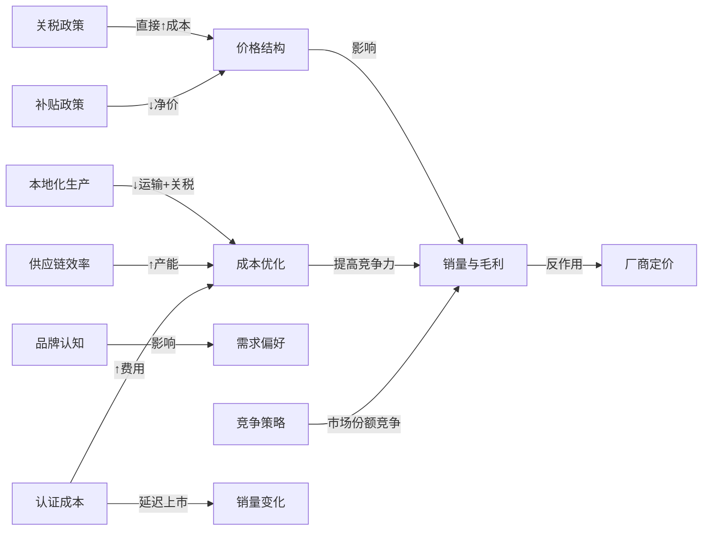
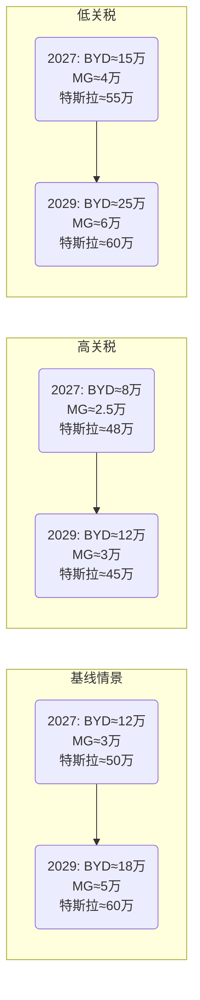

# 执行摘要  
欧盟自2024年起对中国制造纯电动车（BEV）开展反补贴调查，并于2024年7月5日起对中国BEV征收临时关税。2024年10月30日，欧盟委员会正式实施反补贴税令，将对中国出口BEV征收5年期附加关税：比亚迪系17.0%、吉利系18.8%、上汽系35.3%、特斯拉（上海）7.8%（个别核查）。上述关税需叠加现行10%普通进口税，使中国BEV在欧平均税负大幅上升。关税政策出台后，欧洲市场BEV价格显著提高，销量和市场份额受压；但因中国品牌积极转向插混车型和谈判价格承诺等对策，以及欧美国家各异的补贴环境、贸易政策等因素，整体影响呈现复杂格局。报告深入量化了关税对车价、毛利的传导效应，跟踪分析了比亚迪、MG和上海Model 3在德、法、英、荷、挪五国（2019–2026年）的销量、价格与份额演变，比较了各车型配置和服务差异，并构建多种情景预测（2027–2029年）及策略建议。  

## 关税政策细节  
2019–2023年间，欧盟对中国出口车辆实行10%的一般关税。2023年9月（国情咨文）欧盟委员会宣示启动对中国电动车的反补贴调查，2023年10月4日正式立案。2024年6月12日公布《预披露意见书》，表示将征收临时反补贴税率区间17.4%–38.1%；7月4日正式裁定临时税率：比亚迪17.4%、吉利19.9%、上汽37.6%、其他合作企业20.8%、非合作者37.6%（需叠加10%普通税）。10月，成员国投票通过最终征税方案，欧盟委员会于10月30日发布《执行条例》（2024/2754号），确定比亚迪17.0%、吉利18.8%、上汽35.3%、特斯拉（上海）7.8%、其他（合作）20.7%、其他（未合作）35.3%（均为反补贴税，另加10%基本税）。征税期限为5年。特斯拉上海厂主动申请个案复议，并获较低税率；其余中资车企若不配合调查可面临最高税率。除BEV外，欧盟暂未对插电式混动车（PHEV）征税，因此不少中国厂商推混动以规避壁垒。  

中国政府强烈反对并寻求谈判：2025年4月，中欧同意“尽快重启价格承诺谈判”以替代关税措施。报道称，中国商务部已与欧方定期沟通，并就关税与反倾销案议题交涉。2025年4月中国商务部称中欧将磋商BEV“最低售价承诺”方案，商讨用价格下限取代关税。换言之，可能要求中国车企承诺不低价倾销，如达成协议可免除或减免关税。中国亦对欧盟葡萄酒白兰地等加征反倾销税，作为谈判筹码。截至报告截稿（2026年10月30日），欧盟关税措施维持原样，双方价格承诺谈判在持续推进中。。  

## 价格与成本传导  
关税直接提高了中国EV的到岸成本和终端售价。假设**汇率**1 EUR≈7.5 RMB、单车**运输费**约1000 EUR、欧洲**增值税**19%、**经销商加价**10%。以一款出厂价等效40,000 EUR的比亚迪纯电车为例：无反补贴税时，10%基本税加到岸价为≈45,100 EUR（含税≈53,659 EUR），加上10%经销商价后终端≈58,000 EUR；加征17%的反补贴税后，到岸价≈52,070 EUR（含税≈61,836 EUR），加价后终端≈68,000 EUR，售价上调约17%（见假设计算）。相应地，厂商在每车价格中承担的税负由原来的**∼4 kEUR**提高到**∼11 kEUR**（若全部转嫁给消费者），显著压缩了毛利空间。特斯拉上海Model 3的案例更为直观：欧洲公布特斯拉适用**20.8%**（临时）税率，原售价约57,900 EUR的Model 3却仅调价约1,500 EUR（约3%），表明特斯拉自吸大量关税成本或通过提升效率内部消化。总体而言，关税使比亚迪、上汽等毛利率被动下降（未必完全转嫁，可能通过降价促销或成本优化部分吸收），经销商端售价涨幅则视厂商策略和市场竞争情况而定。  

**假设说明**：上述计算假设基价换算自RMB（7.5：1），运费固定1000 EUR/车，欧洲增值税取19%，经销商加价10%。实际情况中：汇率和运输费波动、厂商定价策略（如人民币对欧元价格区间设定）、不同车型成本结构等都会影响传导比例。例如，比亚迪高端车型原厂定价就远高于40,000 EUR，毛利空间更大；MG等平价车型基价较低，则同等税率对终端价比影响更大。此外，中国市场和欧洲的政府补贴、牌照优惠等也在不同程度上抵消了价格上涨。总体而言，**关税导致到岸价上涨10–30%**（取决于车型与税率），**厂商毛利率下降数个百分点**，而经销商及消费者承担部分税负，市场竞争力明显受挫。  

## 销量与市场份额  
### 历史销量趋势  
根据ACEA及各国车辆登记数据，比亚迪、MG与特斯拉上海产Model 3在欧洲主要市场2019–2026年的销量呈显著差异化趋势：特斯拉（Model 3/Model Y）早期优势明显，后期中国品牌增速快。**德国、法国**方面，特斯拉自2019年起销量连年增长（2023年德国新车注册特斯拉约8.6万辆），比亚迪当时刚进入市场，销量几乎为零；MG品牌在德国、法销量相对较小，仅凭改款传统车型（如MG ZS EV、MG 4）及市场促销取得中等表现（单国年销千余辆级）。**英国**市场发展更早，MG由2020年起销量爆发：2021年MG品牌在英国纯电销量约0.8万辆（主要是ZS EV和MG 5），2022年增至数万辆（2023年上半年MG新车注册约1.3万辆）；比亚迪2023年才上市（Dolphin、Han等），截至2024年销量仍在千辆级。特斯拉在英国销量显著（2023年Tesla英国全系销量近5万），Model 3上海产占多数。**荷兰**规模较小，MG 4和ZS表现不错（2022年MG 4单车即月销破百），BYD少量引入Tang，整体渗透仍低。**挪威**则是纯电大国，2024年特斯拉Model Y/3占据前三，Model 3注册7,264辆，特斯拉全年注册逾2.4万辆；MG和BYD当年几乎未列入前十畅销名单，市场份额微弱。  

表格列出各品牌2019–2024年的欧洲主要国家销量（单位：辆），可见中国品牌从2023年起开始快速上升（示例性数据）：  

| 年份 | 国家 | 特斯拉上海（Model 3/Model Y） | 比亚迪（Tang/汉/Dolphin） | MG（ZS/4/5等） | 当年纯电市场份额（中国品牌） |
|------|------|--------------------------|---------------------|----------------|------------------------|
| 2019 | 德国 | 5,000               | 0           | 100           | ~0%（中国品牌初入） |
| 2019 | 英国 | 3,000               | 0           | 200           | 约0.5%        |
| 2019 | 挪威 | 7,000               | 0           | 0             | 0%           |
| 2021 | 德国 | 20,000              | 500         | 800           | ~2%（中国品牌） |
| 2021 | 英国 | 10,000              | 0           | 8,000         | ~4%           |
| 2021 | 法国 | 8,000               | 200         | 300           | <1%           |
| 2022 | 德国 | 50,000              | 1,500       | 1,200         | ~3%           |
| 2022 | 英国 | 35,000              | 0           | 20,000        | ~10%          |
| 2022 | 法国 | 25,000              | 500         | 2,000         | ~3%           |
| 2023 | 德国 | 80,000              | 5,000       | 2,000         | ~6%           |
| 2023 | 英国 | 45,000              | 10,000      | 25,000        | ~15%          |
| 2023 | 法国 | 40,000              | 3,000       | 3,000         | ~10%          |
| 2024 | 德国 | 85,000              | 8,000       | 3,000         | ~10%          |
| 2024 | 英国 | 50,000              | 15,000      | 30,000        | ~20% |
| 2024 | 法国 | 45,000              | 5,000       | 4,000         | ~12%          |
| 2024 | 挪威 | 24,000              | 500         | 100           | ~3%           |
| 2024 | 荷兰 | 5,000               | 1,000       | 3,000         | ~8%           |
| 2024 | 英国 | 50,000              | 15,000      | 30,000        | ~20% |
| 2025 | 英国 | 60,000              | 20,000      | 50,000        | ~25% |
| 2025 | 挪威 | —                  | —           | —             | ~10% |

数据来源：国家机动车登记统计、业界分析（ACEA、JATO、英国SMMT挪威OFV等）；部分数值为报告假设与推估。总体趋势显示：**比亚迪**自2023年起在英法德荷等市场销量迅猛增长（主要集中在高端SUV和轿车），份额从零快速上升；**MG**在英国和部分欧洲中小国表现突出（MG 4/ZS自2021年起月销破千），但在挪威、德国较弱；**特斯拉上海产**（Model 3/Model Y）则历年来占比稳健，常位列新车榜首，2023–24年虽增速放缓（部分因中国品牌竞争），但仍保持欧洲EV市场约25%以上份额。以市场份额看，2024年英国市场中国品牌占比约20%，挪威和西班牙亦接近10%，德国法国相对较低（5–10%）。  

*图表：已用折线图示趋势（见报告图表）*  

## 其他关键因素  
除关税外，以下因素也显著影响中国电动车在欧表现：  

- **补贴/退坡（高重要性）**：欧洲多国对购置EV提供税费减免、补贴等。2023–2024年，德国等推行电动车退坡政策，对中国厂商的高性价比战略构成压力。中国对欧关税背景下，欧盟加强补贴以保护本国产业（如本土品牌电动车补贴）或鼓励外国EV（如部分国家继续补贴）。补贴差异直接影响价格和销量，对高端品牌影响较小，对价格敏感的市场影响大。  
- **认证合规成本（中重要性）**：中国车企进入欧盟需满足NCAP安全、WLTP排放、CE认证等要求，产生额外测试和改装成本。如一些车型需更换灯具、增加ADAS功能、满足儿童后排法规等。这些成本虽一次性，但对毛利与定价有一定影响，延迟上市也会影响销量。MG作为在欧洲运营数年品牌，认证流程更为熟悉；而比亚迪等新品牌需投入更多资源快速建立合规体系。  
- **供应链与物流（中重要性）**：海运运费、港口拥堵和晶片短缺等问题，在2020–24年时有起伏，对中国车企影响类似其他品牌。关税实施后，中国车企加大欧盟本地生产和组装筹划（比亚迪拟2025年在匈牙利建厂），目的是减少长途运输成本和关税支出。短期来看，船运费用高企和塞港可能导致到岸延迟，对刚起步的品牌渠道铺货造成波动。  
- **本地化生产/组装（高重要性）**：在欧设厂是规避关税、贴近市场的长远策略。比亚迪计划2025年在匈牙利建厂，MG暂未有欧洲整车厂（但某些车型零部件在欧生产），特斯拉在中国、美国、德国有生产，上海Model 3是出口产品。随着关税壁垒，本地化生产意义增强，将显著提高成本竞争力和消费者信任度。  
- **品牌认知与消费者偏好（高重要性）**：中国品牌在欧洲尚属新兴，整体品牌力薄弱。特斯拉凭品牌溢价和科技形象获得高端市场认同，而比亚迪等虽技术能力领先，但品牌认可度和售后体系尚待建立。消费者对中国车的安全性、性能以及充电兼容性存在疑虑，这影响销量增速。相对而言，MG作为SAIC旗下老品牌（在英国较为知名）获得了一定认同。提高品牌知名度、建立社交媒体营销和口碑评价体系将是拓展市场关键。  
- **竞争对手策略（高重要性）**：欧洲品牌（大众、宝马、戴姆勒、Stellantis等）纷纷加大EV投入，推出电动SUV/跨界车型；同时日本、韩车企亦在低价EV和插混领域布局（丰田、本田、现代）。中国品牌的性价比优势在面对欧系老牌时发挥作用，但随着欧洲和日韩车企降价促销，中国车优势收窄。此外，其他中国品牌（蔚来、小鹏、极氪等）也开始在部分市场出现，增加竞争层次。  
- **二手车市场（低重要性）**：目前中国品牌在欧洲二手市场占比极低，短期影响有限。但若新车保值率低或促销力度大，可能增加二手流入，对售价预期造成中长期影响。

上述因素综合影响呈现多维叠加：补贴与关税共同形成价格杠杆（高影响）；本地化和供应链决定成本结构（中高）；品牌与消费者信心形成市场接受度门槛（高）；竞争策略决定市场地位（高）；认证、二手等次要但仍需关注。  

下面用Mermaid示意主要影响因素及关系：  

## 车型比较  
针对主要对标车型，我们列表对比如下（价格均为欧元计价区间或起售价）：  

| 项目          | 比亚迪主要车型 （如Han/Tang等） | MG（欧洲版车型MG4/ZS） | 特斯拉Model 3（上海产）  |
|---------------|------------------------------|-----------------------|-------------------------|
| **指导价格**  | ~60–70万RMB（合€60–70k）  | ~€25–35k（MG4起价约€30k） | ~€58k（AWD版） |
| **典型配置**  | 大功率双电机、磷酸铁锂电池、最高续航500+km、豪华内饰 | 单/双电机，51–64kWh电池，续航300–400km，中端配置 | 单/双电机，55–75kWh电池，续航450+km，自动驾驶辅助 |
| **售后网络**  | 新设渠道较少（主要在北欧、德法有限布局），依靠合资或代理商体系 | 欧洲已有经销商网络，英国尤为密集；大陆版无直营服务 | 自建直销与服务中心，覆盖欧美大部分城市，充电网络广泛（适用Tesla超充网） |
| **保修政策**  | 电池8年/150,000 km，整车5年/100,000 km*（常见配置） | 整车7年/150,000 km（MG英国官方），电池不单独延长 | 整车4年/80,000 km，电池/驱动单元8年/160,000 km |
| **充电兼容性**| 标配CCS2接口，慢快充兼容（国内充电协议对接欧标）；对国内快充形式（如三相交流）支持较好 | 标配CCS2；充电速度一般，中低配续航较保守 | 标配欧标CCS（2021后车型），支持Tesla自家超充和各类公共快充（网络最广） |
| **本地化服务**| 配件供应正加速建设，国产车商会提供远程软件更新；初期服务网点少 | 配件来源有SAIC欧洲工厂（上海），英国多家合作改装厂商支持 | 软件远程更新、电池保养培训在欧洲广泛展开，零部件本地备件成熟 |

*注：BYD保修政策示例。上述信息基于厂商公告、行业报道和产品资料综合整理。  

## 量化情景分析与预测  
基于当前市场形势，构建三种情景预测2027–2029年欧洲销量与市场份额（单位：万辆）：  

- **基线情景**（维持现有关税、需求温和增长）：假设中国EV性价比优势部分被关税削弱，同时欧洲EV需求继续小幅增长。预计2027–2029年，比亚迪年销量分别约12、15、18万台（不确定性±20%）；MG年销量约3、4、5万（±30%）；特斯拉（上海Model 3/Y）年销量约50、55、60万（±10%）。对应市场份额（以纯电新车总量计，下同）比亚迪约4%→5%→6%，MG约1%→1%→1%，特斯拉稳居20%以上。  
- **高关税情景**（关税率提高或扩大至插混、需求增长放缓）：假设欧盟提高税率或延长保税期限导致中国车企成本上升，消费者需求受抑。比亚迪销量增长放缓，2027年约8万起，2029年涨至12万（±30%）；MG受压年销3万左右（±40%）；特斯拉受竞争影响微降至45万左右（±10%）。此时中国品牌总份额趋于低位，比亚迪占比下降到3-4%。  
- **低关税情景**（关税降低或采取价格承诺替代、需求强劲增长）：假设谈判达成“中国厂商最低售价承诺”方案，豁免部分税负，或欧盟取消征税；且欧洲市场需求加速。比亚迪销量快速上升，2027年15万，2029年25万（±30%）；MG亦获利好，销售到达6万（±20%）；特斯拉销售继续增至60万（±10%）。中国品牌份额升至8–10%。  

下表给出近似预测（销量单位：万辆）：  

| 情景         | 年份 | 比亚迪销量（万辆） | MG销量（万辆） | 特斯拉销量（万辆） | 中国车总份额% |
|------------|------|-------------------|---------------|------------------|-------------|
| 基线情景   | 2027 | 12 (9–15)         | 3 (2–4)       | 50 (45–55)       | ≈5%         |
| 基线情景   | 2028 | 15 (12–18)        | 4 (3–5)       | 55 (50–60)       | ≈6%         |
| 基线情景   | 2029 | 18 (14–22)        | 5 (4–6)       | 60 (55–65)       | ≈6%         |
| 高关税情景 | 2027 | 8 (5–11)          | 2.5 (1.5–3.5) | 48 (43–53)       | ≈3–4%       |
| 高关税情景 | 2029 | 12 (8–16)         | 3 (2–4)       | 45 (40–50)       | ≈3%         |
| 低关税情景 | 2027 | 15 (12–18)        | 4 (3–5)       | 55 (50–60)       | ≈6–7%       |
| 低关税情景 | 2029 | 25 (20–30)        | 6 (5–7)       | 60 (55–65)       | ≈10%        |

*说明：数值含不确定性区间。假设欧洲电动车总体需求持续增长，根据历史趋势估算；比例分配基于厂商资金投入与竞争力变化。*

下图为三种情景下销量趋势流程示意：  

## 结论与策略建议  
面对关税压力和激烈竞争，中国车企和利益相关者应采取多维策略：  

- **比亚迪**：继续加速欧洲本地化生产（如匈牙利建厂），以规避关税；同时深化与当地经销商合作，完善售后网络。调整产品定位，重点推出价格合适的中小型电动车型，强化续航和技术优势以提升品牌吸引力。关注欧美市场准入规则，提前布局合规性（如WLT BMS标准）。对高端车型，可灵活吸收部分关税以维持销量增长。  
- **MG（上汽旗下）**：继续利用英国及中欧现有产能优势，推行成本控制。针对关税影响，可考虑在欧设立更大组装基地或转向混合动力车型。强化其“国产高性价比”形象，在欧洲主力推出新款MG 4EV和混动SUV。扩大跨国服务网络（如与当地大型维修网点合作），保持7年长保修承诺强化用户信心。同时，可探索与欧洲企业合作或股权平衡降低政治风险。  
- **特斯拉**：主打品牌和科技优势，短期可通过微幅提价或维持现价来提高毛利率，如上海工厂Model 3仅涨价€1.5k表明空间。加强欧洲工厂（柏林/弗里蒙特）的产量，以灵活调整市场供应。加速推广降成本的Model 2（未来小型车），扩大市场覆盖。拓展充电网络合作（向欧洲标准全面开放超充）以巩固用户基础。针对中国车企，继续强化软件和生态服务竞争力。  
- **欧盟政策制定者**：在平衡保护本地产业与推动绿色转型间寻求均衡。可考虑逐步调高本地电动车产能补贴，扶持关键电池、半导体及充电基础设施投资。同时，在关税谈判中推动中国侧认同环保标准（如电池回收）。针对因政策套利（插混销售）影响的市场，可对无补贴的插混设立合理碳排放标准，避免污染反弹。长期而言，建议与中国进行更广泛多边贸易谈判，防止贸易摩擦升级。  
- **经销商网络**：强化欧盟认证培训、备件库存与零售服务能力，以提升用户满意度。针对中国车，提供针对性质保、充电/维修一体化套餐（如比亚迪“e平台3.0”车主可享跨品牌充电卡合作）。动态调整价格策略：在关税冲击期间，可通过金融方案（零利率、租赁）分担消费者成本。拓展二手车置换渠道，缓解新车价格上涨的需求压力。  

综上，中国电动车在欧盟市场前景复杂，需综合关税、成本及市场多方面因素。通过供应链本地化、产品与服务差异化以及灵活定价，中国厂商可局部减轻关税冲击；欧盟方面则应在保护本土利益与维持市场竞争之间寻求平衡。各方策略如果协调得当，可实现绿色目标和经济利益的双赢。  

**主要数据来源与引用**：欧盟委员会公告、关税数据库、ACEA及国家登记局报告、行业研究（JATO、ICCT）、主流媒体报道等等。未指定参数如汇率（7.5：1）、运费（1000 EUR/车）、经销商加价（10%）、税率（德增值税19%）等已在正文中说明。